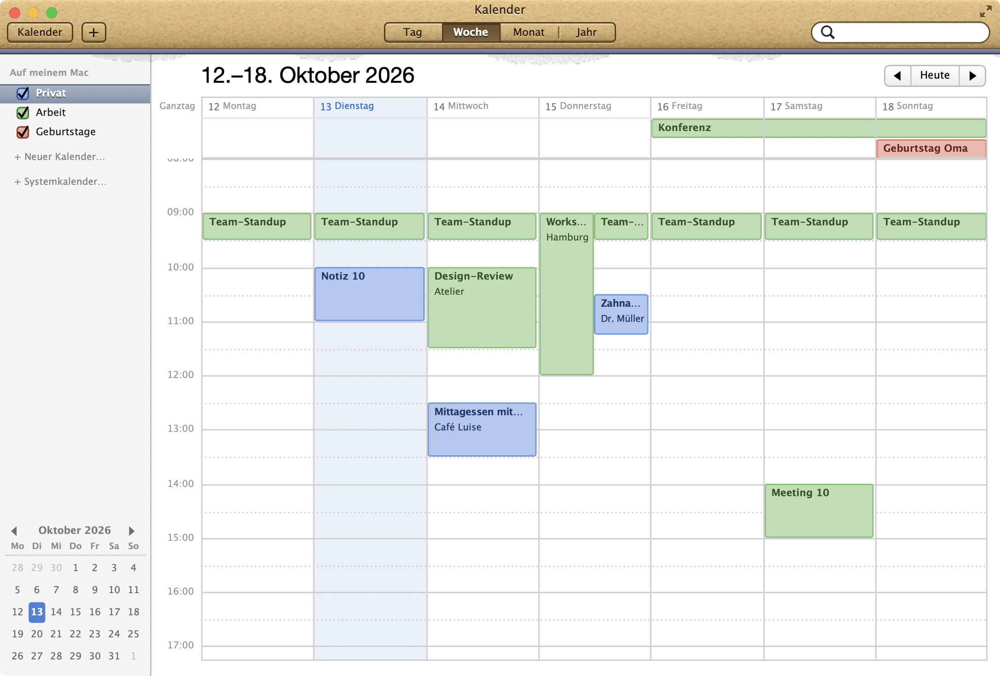
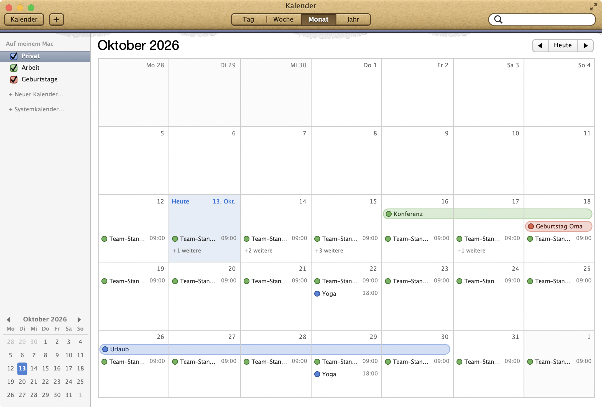
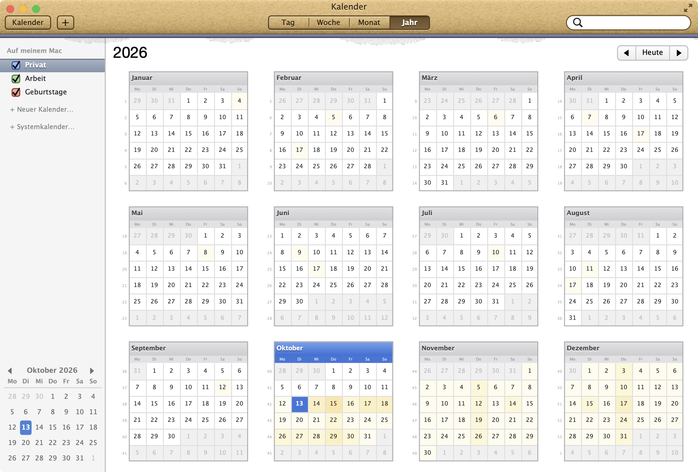
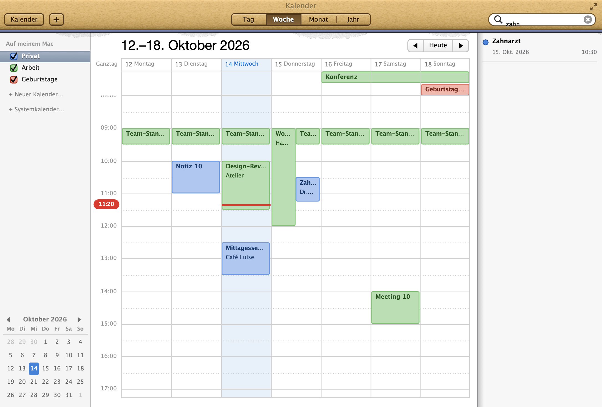
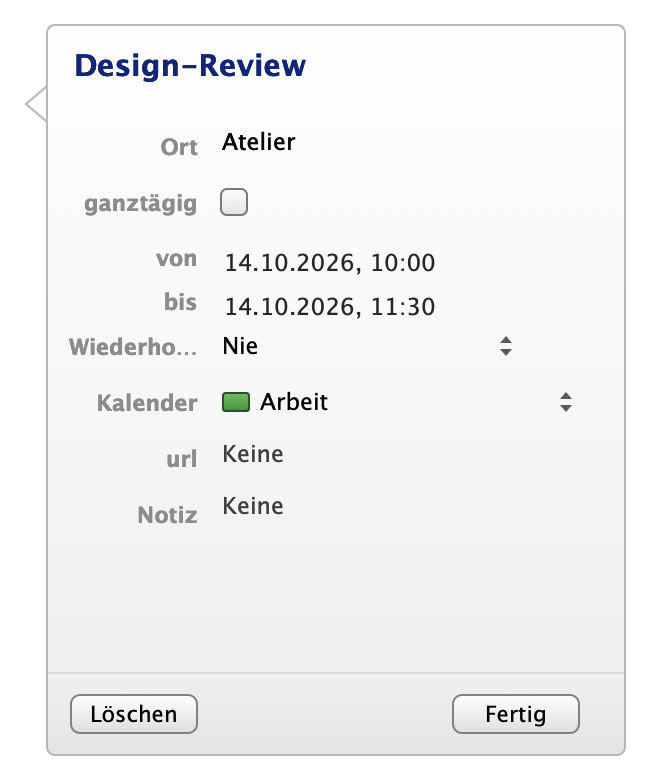
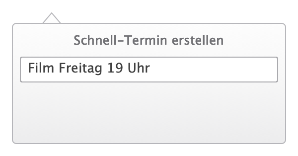
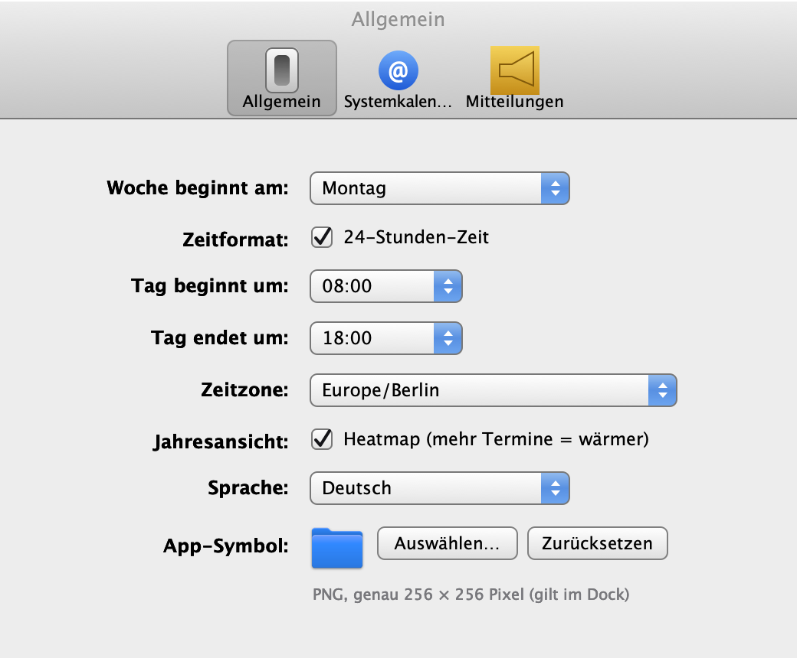

# RetroCal

A standalone macOS calendar in a skeuomorphic retro look: leather header, torn paper edge, glass buttons. No mock-up – events can be created, moved, repeated, searched and synced with your system calendars (iCloud, Google, Exchange).

<p align="center"></p>

> Swift 5.9 · AppKit + SwiftUI · macOS 14 or later · Apple Silicon and Intel · English and German · GPL-3.0
>
> **Note:** RetroCal is an independent project and is not affiliated with Apple Inc. The design is *inspired by* OS X 10.8. Apple, Mac, macOS, OS X and Mountain Lion are trademarks of Apple Inc.

## Features

- **Views** – day (list and hour grid), week, month, and year with heatmap and week numbers; sidebar with mini month; page-turn animation (two-finger swipe).
- **Events** – create, edit, duplicate, delete; all-day, multi-day, overlapping; move and resize with the mouse (Esc cancels); repeats from daily to yearly with "only this / all".
- **Quick event** – one sentence is enough and the interpretation is shown before saving, e.g. `Yoga every Wednesday 6pm at Studio Nord`, `Workshop in 3 days from 2pm to 4pm`, `Dentist March 5th 2027 at 3pm for 90 minutes`.
- **Search** – suggestions below the field (events, places, people, notes), result list on the right.
- **Calendars** – local calendars (name, color, show/hide) and system calendars via EventKit – read, edit, rename, recolor, delete (only where the account allows it).
- **iCalendar** – import `.ics` (double-click, Dock, menu) and export (calendar or single event); unreadable entries are reported individually.
- **Keyboard and VoiceOver** – undo/redo, context menus with copy/paste/change calendar, full keyboard and VoiceOver support, English and German, 24/12-hour time, week start, day range, time zone.
- **Custom app icon** – choose a PNG (exactly 256 × 256 pixels) in the settings; it applies to the Dock while RetroCal runs.
- **Privacy** – everything stays local, no network access; calendar access is requested only when you enable it.

## Screenshots

<table>
<tr>
<td></td>
<td></td>
</tr>
<tr><td align="center">Day</td><td align="center">Month</td></tr>
<tr>
<td></td>
<td></td>
</tr>
<tr><td align="center">Year with heatmap</td><td align="center">Search</td></tr>
<tr>
<td> </td>
<td></td>
</tr>
<tr><td align="center">Event · Quick event</td><td align="center">Settings</td></tr>
</table>

*All images show invented demo events.*

## Installation

Download the signed and notarized DMG from the [latest release](../../releases) (universal: Intel and Apple Silicon, macOS 14 or later), open it and drag the app to *Applications*. Calendar access is requested only when you enable system calendars.

## Build from source

```bash
./build.sh                       # debug build → build/RetroCal.app
./release.sh --notarize          # universal release, Developer ID signature, DMG, notarization
swift test                       # date/recurrence logic, editor, parser, iCalendar, performance
python3 Reference/gen_assets.py  # re-generate the textures (see "Own assets")
```

`release.sh` needs a "Developer ID Application" certificate in the keychain and a `notarytool` profile (`xcrun notarytool store-credentials "Retromac" …`).

## Testing

`swift test` covers recurrence, editor, quick-event parser, iCalendar import/export and performance. `Reference/compare.py` compares a rendered image pixel by pixel with a reference screenshot (overlay, difference image, metrics).

## Own assets

Leather grain, paper edge and the full-screen symbol are generated from random noise by `Reference/gen_assets.py` (reproducible, no third-party images); the script writes `Sources/RetroCal/MLCalendarAssets.swift`. The app icon (`Resources/AppIcon-source.png`) was created with an AI image generator and cut out.

## Data & privacy

Local calendars: `~/Library/Application Support/RetroMac/MLCalendar.json` (atomic writes). System calendars stay in the system (EventKit). No network access.

## Limitations

- Not included: reminders, invitations, printing.
- Changing or deleting system calendars works only where the account allows it.

## License & legal

- **Code:** [GNU General Public License v3.0](LICENSE) (GPL-3.0). Copyright © 2026 Maik Klotz.
- **No affiliation with Apple:** RetroCal is an independent open-source project, neither authorized nor endorsed by Apple. No Apple images, fonts, sounds or textures are included (textures are generated, fonts come from the installed system). Apple, Mac, macOS, OS X and Mountain Lion are trademarks of Apple Inc.
- **App icon:** `Resources/AppIcon-source.png` and the icon files derived from it are AI-generated and are **not** covered by the GPL; all rights reserved. Forks should use their own icon.
- **Distribution:** GitHub only (source and notarized releases), not the App Store.
